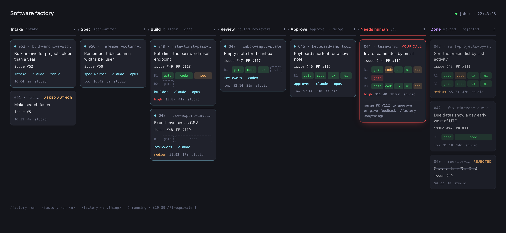
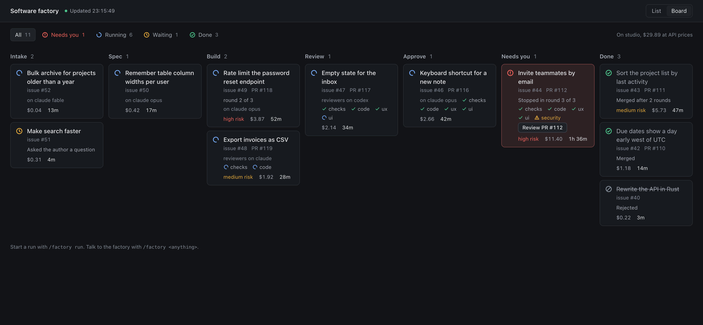
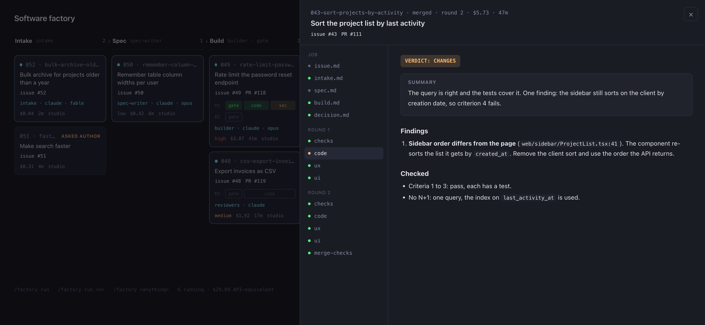

# Software Factory for Claude Code and Codex

A software factory that works through your GitHub issues. Label an issue
`factory`, run `/factory run`, and agents decide whether it's worth building,
write a spec, build it, test it with your own checks, review it, and open a
pull request that closes the issue. The approver merges what it's sure of and
hands you the rest.



## Install

Open Claude Code in your project and paste:

```text
Install this software factory in this project from the reference repository:

https://github.com/EvermillAI/software-factory
```

Your agent reads [`INSTALL.md`](INSTALL.md), copies the skill, agents, scripts
and dashboard, fills `factory/checks.sh` with your project's real test, lint,
typecheck and build commands, tailors the reviewers to your stack, creates the
GitHub labels, and checks that `checks.sh` passes on `main`.

To move to a newer release later, run `/factory update` (or
`factory/bin/update`). It merges the release into the factory's files, keeps
what the installer tailored to your project, and leaves the commit to you.

You need Claude Code 2.1.257 or later, `python3`, and an authenticated
[`gh`](https://cli.github.com/) that can push to the repo.

## The loop

```
issues labeled `factory`
        │
        ▼
intake (fable) ── NEEDS-INFO → asks the author on the issue, waits for a reply
        │         REJECT     → says why on the issue, removes the label
        ▼ ACCEPT, maybe rescoped; rates risk + surfaces
route (script)    picks reviewers and models from config.json
        ▼
spec-writer (opus) → spec.md
        ▼
builder (opus) → commits, pushes, opens a draft PR "Closes #n"
        ▼            ▲
gate (script) ─FAIL──┤  factory/checks.sh, while the reviewers that only read the code review
        ▼ PASS       │
reviewers ─CHANGES───┘  code (haiku | sonnet), + ux & ui on UI changes, + security
        ▼ all PASS
approver (opus) ── APPROVE  → sync with main, gate again if main moved, gh pr merge
                └─ ESCALATE → PR ready for you, issue labeled factory:needs-human
        ▼ merged, after more than one round or after your feedback
retro (sonnet) → a PR with new rules in factory/LESSONS.md, for you to merge
```

One Claude Code session orchestrates every job, `concurrency` at a time
(default 3). Each job gets its own git worktree and branch. All state lives in
`factory/jobs/`, so if the session dies, `/factory run` picks every job back up.

## Learning from its mistakes

A job that needed a second round, or your feedback, went wrong somewhere. After
its PR is merged, the `retro` agent reads the failed checks, the reviews that
asked for changes and your feedback, and writes what a later job should know as
one-line rules in `factory/LESSONS.md`. The spec-writer, the builder and the
reviewers read that file at the start of every job, on every computer and on
every agent CLI.

The retro never changes the file on `main`. It opens a pull request, and a rule
counts once you merge it. The file holds at most `max_lessons` rules (default
30); past that the retro has to merge or drop old ones. A job that passed in
one round gets no retro.

## Several computers

Run `/factory run` on as many machines as you like. Starting an issue creates
the branch `factory/<issue>` on GitHub, which only one machine can do, labels
the issue `factory:in-progress` and comments which machine has it. The others
skip it. A job stays on the machine that started it. If that machine is gone,
`/factory release <n>` frees the issue.

## Codex

Open Codex in the project and ask it to `factory run`. It loads
`.agents/skills/factory/SKILL.md` and runs the same agents through
`factory/bin/agent`, one job at a time. Models and sandboxes are in
`factory/config.json` under `codex`. Codex jobs show no cost.

## Hybrid: Claude and Codex review each other

`runtime` in `factory/config.json` says which CLI runs a role. Set

```json
"runtime": { "reviewers": "other" }
```

and the reviewers run on the CLI that isn't orchestrating: start the factory in
Claude Code and Codex reviews Claude's build, start it in Codex and Claude
reviews Codex's build. Values are `host` (the default), `other`, `claude` and
`codex`. Keys are role names (`builder`, `approver`, `reviewer-security`, ...)
or `reviewers` for all of them; a role name wins. Both CLIs must be installed
and signed in on the machine.

## Gemini, Cursor and Grok

`runners` in `factory/config.json` holds a command template for each of the
three. Use a runner's name in `runtime` to give it a role:

```json
"runtime": { "reviewer-code": "gemini", "reviewer-security": "grok", "reviewer-ux": "cursor" }
```

Before a runner works on a machine:

1. Install its CLI and sign in: `gemini`, `agent` (Cursor) or `grok`.
2. Compare `<cli> --help` with the runner's `cmd`. The templates were written
   from the docs and have not been run.
3. Fill in `runners.<name>.models`: which of that CLI's models stands in for
   `haiku`, `sonnet`, `opus` and `fable`. The script refuses a runner with an
   empty model.
4. Try it: `factory/bin/agent --host claude reviewer-code "Reply with exactly one line: OK"`
   with `reviewer-code` set to the runner. It should print `OK`.

A runner approves every tool call, so the role has full shell and network
access in the repo. Intake and retro never run on a runner. Runner roles show no cost.
Any other agent CLI that takes a prompt, works in the repo by itself and
prints its answer can be added as one more entry.

## Commands

```
/factory run          drain the queue: every open `factory` issue, `concurrency` at a time; also resumes
/factory run <n>      one issue now
/factory release <n>  drop a stale claim another machine left on issue <n>
/factory <anything>   talk to the factory: ask about jobs, give feedback, file a feature
```

You approve by merging the PR on GitHub. To change an escalated PR, tell the
factory what you want with `/factory`. To drop a job that waits on you or on
its author, tell the factory to reject it.

## What's in here

```
.claude/
  skills/factory/SKILL.md     the orchestrator: queue, concurrency, the pipeline
                              (.agents/skills/factory/SKILL.md is its Codex variant)
  agents/
    intake.md                 fable    worth building? at what scope? risk + surfaces
    spec-writer.md            opus     spec.md
    builder.md                opus     code, commits, the PR, build.md
    reviewer-code.md          routed   correctness, simplicity, tests
    reviewer-security.md      opus     only when intake flags `security`
    reviewer-ux.md            sonnet   only when intake flags `ui`
    reviewer-ui.md            haiku    only when intake flags `ui`
    approver.md               opus     APPROVE or ESCALATE
    retro.md                  sonnet   lessons from a job that needed more than one round
factory/
  config.json                 concurrency, rounds, labels, routing, protected paths, prices
  checks.sh                   your repo's checks (the installer fills it in)
  LESSONS.md                  rules the factory learned; changed only by retro PRs you merge
  bin/job                     the only writer of job.json; refuses illegal moves; merges
  bin/gate                    runs checks.sh in a job's worktree → round-N/checks.md
  bin/route                   risk + surfaces → the job's reviewers and models
  bin/agent                   runs one agent file with `codex exec`
  bin/update                  moves the factory to a newer release, keeps your changes
  VERSION                     the release this project installed
  dashboard.html              the board
INSTALL.md                    instructions for the installing agent
DESIGN.md                     how it works and why
```

[`DESIGN.md`](DESIGN.md) explains each decision.

## Dashboard

```bash
cd factory && python3 -m http.server
```

Open <http://localhost:8000/dashboard.html>. The counts at the top say how many
jobs need you, are running, wait for their author or are done, and each count
is a filter. Below them every job is a row, grouped by what it asks of you:
the ones that need you first, with a link to the PR to review. A running job
shows the six stations it moves along (intake, spec, build, checks, review,
approve), which CLI and model the work runs on, and the verdicts of the
current round. Blue is at work, green passed, amber waits or asked for
changes, red needs you, and every colour comes with its own mark. Click a row
to read every file the job wrote, with the time each was last written. It
works on a phone, and the tab title counts the jobs that need you.

**Board** at the top right switches to a kanban layout: the same jobs, one
column per station. The page remembers the choice, and
`dashboard.html?view=board` opens it directly.





The agent line is what the job planned when it started (`config.json`
`runtime` and the CLI that orchestrates), not a measurement. Each computer's
board shows its own jobs: `factory/jobs/` is local.

Cost is the API-equivalent price of each job's agents, read from Claude Code's
transcripts. On a subscription plan it shows where the spend goes, not what
you're billed.

## Cost and safety

- It opens and merges real PRs and runs on your Claude plan. Start with
  `concurrency: 1` and read every PR until you trust it.
- Intake runs on Fable once per issue. Depending on your plan, Fable can bill
  to usage credits rather than your plan's included usage.
- Only issues labeled `factory` run, and only people with triage or write
  access can add labels. Issue text reaches the agents as quoted data, never
  as their instructions.
- The factory pushes only `factory/*` and `retro/*` branches, merges only
  through `gh pr merge`, and never deploys. It never merges a lessons PR.

## License

[GPLv3](LICENSE).
